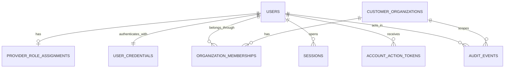

# Story intake

Fill this template for each story you want planned. Keep it copy-paste-friendly: the planner reads **this file and the files in `attachments/`**, nothing else.

- Folder: `.squad/stories/identity-access/identity-customer-ownership-authentication-authorization/intake.md`
- Binaries (screenshots, PDFs, exports): put them in `attachments/` next to this file and list them below.
- Do **not** rely on external links (tracker URLs, wiki, chat) — the planner cannot open them. Paste the content you want considered.

This is **not** an implementation prompt. It is the input to the plan-generation meta-prompt bundled with squad-kit (`generate-plan.md` in the installed package).

---

## Feature

- **Feature name (display):** Identity, Customer Ownership, Authentication and Authorization
- **Feature slug (folder under `plans/`):** `identity-access`

## Tracker (metadata only)

- **Tracker type:** `none`
- **Work item id:** `` *(used in filenames and plan tables; fill manually if empty)*
- **Work item type:** ``
- **Status:** ``
- **Assignee:** ``
- **Labels:** ``

External tracker links are **not** followed by the planner. Keep the id for naming and traceability only.

---

## Title

*(Paste the work item title verbatim. Prefilled when fetched from a tracker.)*

```text
Identity, Customer Ownership, Authentication and Authorization
```

---

## Description

### Outcome

Design and later implement the first Phase 2 security boundary for the Elevator Maintenance Platform: user identity, customer-organization ownership, password authentication, server-side sessions, account recovery, fixed roles, organization membership, resource-level authorization, session revocation, and append-oriented audit events.

This intake is requirements and architecture only. It does not authorize package installation, database migration generation, application code, credentials, deployment, dashboards, or maintenance-domain implementation.

### Implemented baseline to preserve

- npm workspaces: `apps/web`, `apps/api`, and `packages/shared`.
- Dependency direction: web and API may consume the public `@elevator/shared` package; shared remains framework/runtime neutral; applications never import each other's source.
- Express application construction remains separate from HTTP listener/process lifecycle.
- API-owned PostgreSQL and Drizzle schema/migrations remain under `apps/api`; migrations are explicit and never run during API startup.
- Zod validates environment, HTTP, persistence, and shared-contract boundaries.
- The React client remains Arabic-first with English support, synchronized `lang`/`dir`, direction-safe layout, React Router, and TanStack Query.
- `GET /api/health` remains unauthenticated, database-independent process liveness and must not change.
- Errors remain structured and generic without credentials, tokens, stack traces, internal paths, or database details.

### Proposed ownership model — pending product-owner confirmation

The system serves **one elevator installation and maintenance provider company**. That provider manages **multiple customer organizations**. This is not a multi-provider SaaS architecture.

- Provider staff are Super Admins, Admins, and Maintenance Technicians.
- Customer users gain access through active membership in a customer organization.
- A customer organization may have many users and will later own many buildings, elevators, contracts, and maintenance requests.
- Technicians are provider employees and may be assigned work across customer organizations.
- Future organization-owned tables must carry an immutable `customer_organization_id` or derive it through an unambiguous parent relationship.
- No `provider_tenant_id` is required in Phase 2. If multi-provider SaaS becomes a requirement, it requires a separate architecture and migration decision rather than overloading customer organizations.

### Product requirements

#### Account creation and lifecycle

1. There is no public registration endpoint or screen.
2. The first Super Admin is created by an explicit, one-time, interactive operator command that:
   - refuses to run when an active Super Admin already exists;
   - reads the password through hidden interactive input, never a CLI argument, URL, environment value, log, or source file;
   - validates the same password policy used by the API;
   - executes under a transaction and concurrency guard so two operators cannot bootstrap simultaneously;
   - writes an audit event attributed to a system/bootstrap actor;
   - prints no password, password hash, token, connection string, or personal data beyond the normalized email needed for confirmation.
3. Subsequent accounts are invitation-only and created by an authorized provider administrator.
4. New accounts begin in `pending_activation`; activation requires a single-use, expiring, cryptographically random token delivered out of band.
5. Account states are `pending_activation`, `active`, and `suspended`. Deletion is not an account lifecycle operation in this story.
6. Suspended or non-activated users cannot authenticate. Suspending an account revokes every active session in the same transaction.
7. Reactivate, suspend, invite, resend activation, role change, membership change, password change/reset, and session revocation are auditable.
8. Email addresses are normalized consistently and unique case-insensitively. Display email may retain user-friendly casing, but identity lookup uses the normalized form.
9. Privilege-changing operations must prevent self-escalation and must not remove or suspend the last active Super Admin.

#### Password requirements

1. Passwords are hashed with Argon2id using a maintained library; never encrypt or reversibly store them.
2. The encoded hash stores algorithm version, salt, and work parameters so successful login can transparently rehash when policy increases.
3. Implementation must benchmark the deployment target. It must meet at least the current OWASP Argon2id baseline of 19 MiB memory, 2 iterations, and parallelism 1; stronger measured parameters are preferred when operationally safe.
4. Until MFA is implemented, passwords are single-factor authenticators and require at least 15 Unicode code points. Accept at least 64; use a documented upper bound such as 128 to limit hashing denial-of-service.
5. Accept spaces and Unicode, normalize consistently with Unicode NFC before hashing and verification, permit paste/autofill/password managers, and impose no arbitrary uppercase/lowercase/digit/symbol composition rule.
6. Reject commonly used or compromised passwords using an approved local/offline blocklist strategy that never transmits a candidate password to a third party.
7. Do not require periodic password rotation. Require a change after confirmed compromise or administrative reset.
8. Passwords, hashes, reset/activation tokens, session secrets, and CSRF values are prohibited from application logs and audit context.

#### Login and logout

1. Login accepts normalized email plus password and always returns the same public failure code/message for unknown account, wrong password, inactive account, and suspended account.
2. Unknown-account handling performs safe equivalent-cost work to reduce timing-based account enumeration.
3. Successful login creates a fresh opaque server-side session; no authentication JWT or role-bearing token is stored in browser storage.
4. Login rotates any pre-authentication identifier and cannot accept a client-selected session ID.
5. Logout revokes the current server session before clearing the browser cookie and is idempotent.
6. Users can list their own sessions, revoke another own session, and revoke all other sessions.
7. Password reset, suspension, and security-sensitive role changes revoke affected sessions. Password change revokes other sessions and rotates the current session.

#### Password reset and activation

1. Password-reset request always returns the same `202 Accepted` response regardless of account existence or state and should have materially uniform behavior.
2. Reset and activation tokens are generated with a cryptographically secure random source, contain at least 256 bits of entropy, are stored only as digests, expire, and are single-use.
3. Issuing a new token invalidates prior unconsumed tokens of the same purpose for that user.
4. Raw tokens belong in the URL fragment where practical so they are not sent in HTTP request lines or Referer headers; the web client submits the token in a JSON request body over HTTPS.
5. Reset and activation responses set `Cache-Control: no-store`; tokens are never logged.
6. Reset confirmation validates token and password atomically, consumes the token, changes the credential, revokes all sessions, and writes an audit event.
7. Reset does not automatically authenticate the user.
8. Suspended accounts remain suspended after password reset. Public responses do not reveal that state.
9. Email delivery is an injected adapter with sanitized failure handling; provider selection is an open product/operations decision.

#### Session and cookie requirements

1. Generate at least 256 bits of random session entropy. Send the raw token only in the cookie and store only a one-way digest in PostgreSQL.
2. Production cookie baseline: `__Host-elevator_session`, `Secure`, `HttpOnly`, `SameSite=Lax`, `Path=/`, and no `Domain`. Local HTTP development may use a clearly environment-gated non-`__Host-` cookie with `Secure=false`; production must fail closed if secure-cookie requirements are not met.
3. Responses containing authentication or session material use `Cache-Control: no-store`.
4. Enforce both server-side idle and absolute expiration. Proposed defaults are 30 minutes idle and 12 hours absolute; these remain pending product/security-owner confirmation.
5. Do not implement “remember me” until duration and risk requirements are approved.
6. Session lookup always rechecks user status and current role/membership state; the cookie is not the source of permissions.
7. Use an indexed expiration/revocation strategy and bounded cleanup job/command; expired rows must not grow without limit.
8. Store only security-useful metadata with defined retention. Raw IP addresses and complete user-agent strings are not retained indefinitely by default.

#### CSRF requirements

1. Cookie-authenticated unsafe requests (`POST`, `PUT`, `PATCH`, `DELETE`) require a session-bound unpredictable CSRF token in `X-CSRF-Token` plus an exact trusted `Origin` check.
2. The login/session response supplies the CSRF token in JSON; it is never placed in a URL or logged. The web client keeps it in memory, not persistent browser storage.
3. Token validation uses constant-time comparison. Missing/invalid tokens, `Origin: null`, absent untrusted origin evidence, or an origin mismatch fail with `403` before business mutation.
4. `SameSite` and narrow credentialed CORS are defense in depth, not substitutes for CSRF checks or authorization.
5. Before login/recovery, `GET /api/v1/auth/csrf` returns a signed, unpredictable pre-authentication token in JSON and sets a matching host-only pre-authentication nonce cookie. The unsafe request must return the token in `X-CSRF-Token`; strict CORS prevents an untrusted origin from reading it. Rotate/clear the pre-authentication material when a session is created.
6. State-changing business behavior is never exposed through `GET`/`HEAD`, and JSON endpoints reject unsupported simple content types.

#### Authentication abuse controls

1. Apply separate rate-limit policies to login, reset request, reset confirmation, activation, and bootstrap/admin invitation operations.
2. Limits combine a privacy-preserving account key and source-network key; an IP-only limit is insufficient.
3. Use progressive delay/temporary throttling without permanent attacker-triggered account lockout.
4. The production limiter must work across multiple API processes. Because PostgreSQL is the only approved shared infrastructure, plan a PostgreSQL-backed throttle store or require a separately approved shared store; an in-memory limiter alone is development-only.
5. Return `429` with generic content and safe retry metadata. Never disclose whether the account exists.
6. Successful and failed authentication, throttling, recovery, activation, and revocation events produce security audit records without credentials or raw tokens.

### Authorization architecture

#### Policy model

Use a hybrid model:

- Role codes are a small fixed, version-controlled application enum: `SUPER_ADMIN`, `ADMIN`, and `MAINTENANCE_TECHNICIAN` for provider users. `CUSTOMER` authority is established by an active organization membership.
- Permissions are version-controlled policy/action constants, not editable database rows in this phase. A dynamic permissions administration system would add unsafe complexity before requirements exist.
- Relational data supplies scope: provider role assignment, customer-organization membership, and later technician-to-maintenance-request assignment.
- Route middleware authenticates and constructs a minimal request principal. Dedicated policy functions authorize an action against a resource/scope. Repository/query functions enforce the same organization or assignment scope in SQL.
- Every unrecognized role/action/resource combination denies by default.
- IDs are identifiers, not authorization. Never trust client-provided role, organization, owner, assignee, or audit actor fields.
- For object access outside the caller's scope, prefer a consistent `404` where revealing existence would enable enumeration. Use `401` for no valid session and `403` for an authenticated caller who lacks a non-enumerating capability.
- Mutable allow/deny decisions must be made from current database state, not stale client claims.

#### Dispatcher/Supervisor decision

Do **not** add Dispatcher or Supervisor in the initial role set. Admin can own technician assignment and operational supervision while the team and approval workflow are undefined. Add a dedicated role only if product owners confirm one or more of these needs:

- dispatchers must assign work but cannot manage accounts, organizations, or security settings;
- supervisors must approve technician work or reassignment independently;
- audit/separation-of-duties rules prohibit general Admins from performing dispatch;
- operational volume requires a distinct workforce with a stable permission boundary.

Adding a role later requires a permission-matrix review, migration, negative authorization tests, and documentation; it must not be implemented as a name-only alias.

### Role and permission matrix

Legend: `All` = provider-wide; `Scoped` = only through active organization membership or technician assignment; `Own` = caller's own account/session; `No` = deny. Future-domain rows define policy requirements but do not authorize implementing those domains in this feature.

| Capability | Super Admin | Admin | Customer | Maintenance Technician |
| --- | --- | --- | --- | --- |
| Authenticate, log out, reset own password | Own | Own | Own | Own |
| Read/update allowed own profile fields | Own | Own | Own | Own |
| List/revoke own sessions | Own | Own | Own | Own |
| Bootstrap first Super Admin | One-time operator command only | No | No | No |
| Create/activate/suspend Super Admin | All, with last-Super-Admin safeguard | No | No | No |
| Create/activate/suspend Admin | All | No | No | No |
| Create/activate/suspend Customer accounts | All | All | No | No |
| Create/activate/suspend Technician accounts | All | All | No | No |
| Assign provider roles | All, cannot self-escalate or remove last Super Admin | No | No | No |
| Create/update/archive customer organizations | All | All | No | No |
| Manage organization memberships | All | All | No initially | No |
| Read customer organization identity/profile | All | All | Scoped | Only minimum context required by an assignment |
| Read future buildings/elevators/contracts | All | All | Scoped | Assignment-minimum only |
| Create future maintenance request | All | All | Scoped | No unless separately approved |
| Read future maintenance request | All | All | Scoped | Assigned only |
| Update future request workflow/status | All | All | Limited fields, pending domain decision | Assigned workflow fields only |
| Assign/reassign future requests | All | All | No | No |
| Archive future customer maintenance request | All, policy/audit controlled | All, policy/audit controlled | No initially | **Never** |
| Hard-delete future customer maintenance request | No; retain/audit instead | No | No | **Never** |
| View security/authorization audit events | All | Operational subset, pending confirmation | No | No |
| Change or delete audit events | No | No | No | No |

The technician delete/archive prohibition is unconditional: route, policy, service, repository, direct API request, bulk operation, and future real-time command paths must all deny it. No UI state, request ownership, assignment, temporary delegation, or Admin-created assignment may override it.

### Data architecture — design only, no tables in this task

#### Entity relationship



#### Proposed entities and constraints

1. `users`
   - UUID primary key generated server-side.
   - display name, canonical email, normalized email with a unique constraint/index, preferred locale (`ar`/`en`), account status, activation/email-verification timestamp, created/updated timestamps, and optimistic/concurrency version where useful.
   - No role supplied by clients and no password hash in serialized user models.
   - Account status changes use explicit service methods and audit in the same transaction.

2. `user_credentials`
   - One-to-one user foreign key, encoded Argon2id password hash, password-changed timestamp, optional forced-change flag, and hash-policy version/rehash metadata if not already encoded.
   - Never selected by general user repositories or included in shared/browser DTOs.

3. `provider_role_assignments`
   - One active provider role per provider user for the initial model, using a constrained fixed role code: Super Admin, Admin, or Maintenance Technician.
   - Records who assigned it and when. Changes are audited and revoke sessions.
   - Customer authority is not represented here; it comes from organization membership.

4. `customer_organizations`
   - UUID primary key, stable human-facing reference/code if approved, display/legal name fields pending product decision, active/archived status, and timestamps.
   - This is the ownership root for future buildings, elevators, contracts, and customer maintenance requests.
   - Archive rather than hard delete once referenced by business/audit data.

5. `organization_memberships`
   - User and customer-organization foreign keys, active/revoked status, invited/created by, activation/joined/revoked timestamps, and unique `(user_id, customer_organization_id)` membership.
   - An active membership establishes the Customer role for that organization.
   - The schema may support multiple memberships, but whether a customer user may belong to multiple organizations is an open product decision; policy can initially restrict creation to one.

6. `sessions`
   - UUID record ID, unique digest of opaque session token, user foreign key, created/last-seen/idle-expiry/absolute-expiry/revoked timestamps, revocation reason, and minimized device/security metadata.
   - Raw session secrets never enter PostgreSQL. Index user, digest, expiry, and active-session cleanup paths.

7. `account_action_tokens`
   - User foreign key, constrained purpose (`activation` or `password_reset`), token digest, created/expiry/consumed timestamps, and creator/request context safe for audit correlation.
   - Unique active-token semantics per user/purpose enforced transactionally. Raw tokens are never stored.

8. `auth_throttle_buckets`
   - Hashed limiter key, action type, window/counter/backoff fields, blocked-until timestamp, and expiry/cleanup index.
   - Never stores raw passwords, reset tokens, or unbounded raw network identifiers.

9. `audit_events`
   - Append-oriented ID and timestamp; actor kind (`user`, `system`, `bootstrap`), nullable actor user/session IDs, action, target type/ID, optional customer-organization scope, outcome, correlation/request ID, and allowlisted minimized JSON context/before/after fields.
   - No update/delete path for application roles. Critical mutations write audit data in the same transaction; audit failure fails the mutation.
   - Authentication failures that do not identify a user may use a privacy-preserving subject digest and security context with bounded retention.

#### Future relationship requirements

- `buildings` will reference `customer_organization_id` directly.
- `elevators` will derive the organization through a required building and should duplicate organization ID only if a documented consistency constraint prevents cross-organization mismatch.
- `maintenance_contracts` and `maintenance_requests` will have an unambiguous customer-organization owner.
- Technician access will require a future assignment relation linking a technician user to a maintenance request with assignment status and validity. Until that relation exists, technicians have no customer-domain access.
- Organization membership alone never grants a technician access; technician scope is assignment-based.

### Authentication and request architecture

1. API composition receives identity repositories/services through explicit dependencies; modules do not read environment globals or create pools on import.
2. Authentication middleware reads the opaque cookie, hashes it, loads an unexpired/unrevoked session plus current active user, and creates an immutable principal containing only user ID and current scope facts.
3. Authorization middleware/policy functions require an explicit action and resource/scope. Missing policies deny.
4. Domain services request scoped repositories rather than unrestricted rows. Customer queries join or constrain by active membership and organization ownership in SQL. Technician queries will join active assignments in SQL.
5. Shared Zod contracts define safe request/response DTOs and stable error codes; they never export password hashes, token digests, internal audit context, or database models.
6. The frontend may use server-returned capabilities to hide unavailable controls, but the API always repeats the full authorization check.
7. Unsafe browser requests send credentials plus `X-CSRF-Token`; the generic API client handles `401`, `403`, and token refresh/session-expiry without exposing internals.

### API endpoint specification

All new endpoints use `/api/v1`. `/api/health` remains unchanged. JSON bodies and responses use shared Zod contracts where consumed by both applications. Authentication responses use `Cache-Control: no-store`.

| Method and path | Access | CSRF | Required behavior |
| --- | --- | --- | --- |
| `GET /api/v1/auth/csrf` | Public, rate-limited | Bootstrap endpoint | Return no-store signed pre-auth token and set matching host-only nonce cookie; expose no account/session state |
| `POST /api/v1/auth/login` | Public, rate-limited | Exact origin and valid pre-auth token required | Validate credentials generically, create fresh session, rotate pre-auth material, set session cookie, return safe current-user/session view and session-bound CSRF token |
| `POST /api/v1/auth/logout` | Authenticated | Required | Revoke current session, clear cookie, return `204`; idempotent |
| `GET /api/v1/auth/session` | Authenticated | Safe method | Return safe user, provider role, active memberships/capabilities, session expiry, and session-bound CSRF token; never hashes/digests |
| `GET /api/v1/auth/sessions` | Authenticated | Safe method | List minimized current user's active sessions and identify current session |
| `DELETE /api/v1/auth/sessions/:sessionId` | Authenticated owner | Required | Revoke only caller-owned session; audit; do not accept arbitrary user ID |
| `POST /api/v1/auth/logout-others` | Authenticated | Required | Revoke all caller sessions except current; audit; return `204` |
| `POST /api/v1/auth/password-reset/request` | Public, strongly rate-limited | Exact origin/pre-auth CSRF | Always return generic `202`; enqueue delivery only for eligible account |
| `POST /api/v1/auth/password-reset/confirm` | Public with one-time token, strongly rate-limited | Exact origin/pre-auth CSRF | Consume token and update credential atomically, revoke sessions, audit, return generic success |
| `POST /api/v1/auth/activation/confirm` | Public with one-time token, strongly rate-limited | Exact origin/pre-auth CSRF | Set initial password, activate eligible user, consume token, audit; no auto-login |
| `GET /api/v1/me` | Authenticated | Safe method | Return safe profile fields |
| `PATCH /api/v1/me` | Authenticated | Required | Update allowlisted own profile fields only; role/status/email changes use privileged flows |
| `POST /api/v1/admin/users` | Super Admin or Admin within matrix | Required | Invite an allowlisted lower-privilege account; reject client-assigned unauthorized role/scope |
| `GET /api/v1/admin/users` | Super Admin/Admin | Safe method | Paginated, filterable safe account summaries; policy-filtered fields |
| `GET /api/v1/admin/users/:userId` | Super Admin/Admin within matrix | Safe method | Return safe identity/role/membership status or non-enumerating not found |
| `PATCH /api/v1/admin/users/:userId/status` | Super Admin/Admin within matrix | Required | Activate/suspend with hierarchy and last-Super-Admin safeguards; revoke sessions; audit |
| `PATCH /api/v1/admin/users/:userId/provider-role` | Super Admin only | Required | Change provider role without self-escalation/last-Super-Admin violation; revoke sessions; audit |
| `POST /api/v1/customer-organizations` | Super Admin/Admin | Required | Create organization identity only; no building/contract data |
| `GET /api/v1/customer-organizations` | Super Admin/Admin | Safe method | Paginated provider-wide list |
| `GET /api/v1/customer-organizations/:organizationId` | Provider admin or active member | Safe method | Return minimal organization profile under scope policy |
| `PATCH /api/v1/customer-organizations/:organizationId` | Super Admin/Admin | Required | Update allowlisted organization identity/status fields; audit |
| `POST /api/v1/customer-organizations/:organizationId/memberships` | Super Admin/Admin initially | Required | Invite/add Customer membership; prevent provider-role confusion; audit |
| `DELETE /api/v1/customer-organizations/:organizationId/memberships/:userId` | Super Admin/Admin initially | Required | Revoke membership, affected sessions/capabilities, and audit; no user deletion |
| `GET /api/v1/audit-events` | Super Admin; Admin subset pending decision | Safe method | Paginated, filtered, redacted audit view; no mutation endpoints |

Login, reset, and activation use the pre-authentication token plus exact-origin validation. After authentication, unsafe requests use a token cryptographically bound to the current session. Neither token is an authentication credential, and neither is accepted from a URL or persisted in browser storage.

### Error and response requirements

- `400` invalid request/schema; field feedback may be specific only when it cannot enumerate accounts or reveal policy internals.
- `401` missing, invalid, expired, or revoked session with one stable code.
- `403` authenticated but denied, invalid CSRF, or invalid trusted origin; do not reveal hidden resource state.
- `404` unknown or out-of-scope object when existence is sensitive.
- `409` safe business conflict such as duplicate active membership; email uniqueness must not become a public enumeration path.
- `422` may be used for password-policy failure during authenticated/invited flows with safe rule feedback.
- `429` throttled authentication/recovery operation with safe retry metadata.
- Public login/reset/activation failures never expose which credential, token, user state, membership, or organization check failed.

### Audit requirements

- Audit authentication success/failure, logout, session revocation, reset/activation request and completion, account status, role, organization, membership, and bootstrap changes.
- Record actor, action, target, timestamp, outcome, request/correlation ID, relevant organization, and minimized allowlisted context.
- Never record passwords, password hashes, raw/digested session tokens, reset/activation tokens, CSRF tokens, full request bodies, authorization headers, cookies, database URLs, or secrets.
- Administrative mutations and their required audit event commit atomically.
- Audit readers cannot update/delete events. Database operational access remains outside application roles.
- Retention, export, legal access, and source-IP policy require product/security-owner decisions.

### Security threat analysis

| Threat | Required control and verification |
| --- | --- |
| Credential stuffing/brute force | Argon2id, compromised-password blocklist, account+network distributed throttling, generic responses, security audit/alert hooks |
| Account enumeration | Same public login/reset/activation messages and status behavior, equivalent-cost unknown-user login path, no email uniqueness leaks |
| Offline password cracking | Unique salts and calibrated Argon2id; hashes excluded from normal repositories, logs, shared contracts, and backups with broad access |
| Session fixation/hijacking | Server-generated high-entropy opaque IDs, login rotation, digest-only storage, secure `__Host-` cookie, idle/absolute expiry, revocation |
| CSRF/login CSRF | Session-bound token for unsafe authenticated requests, exact Origin validation, JSON-only mutation endpoints, SameSite and strict CORS defense in depth |
| XSS/session theft | HttpOnly session cookie, CSP/security-header plan, React escaping, no session token in local/session storage, no unsafe HTML injection |
| IDOR/BOLA | Organization/assignment scope in SQL, centralized policies, opaque IDs not trusted, negative two-organization tests, non-enumerating errors |
| Privilege escalation/mass assignment | Fixed allowlisted role transitions, hierarchy checks, DTO allowlists, current DB state, session revocation on privilege change |
| Customer cross-organization access | Active membership plus owned resource relationship required for every query/mutation; never accept client ownership fields |
| Technician overreach | Active assignment required for future request access; unconditional policy denial for request delete/archive across every transport |
| Reset/activation token theft/replay | 256-bit random token, digest-only storage, short expiry, one-time atomic consumption, no URL query/logging, session revocation |
| Audit tampering/data leakage | Append-only app API, transactional write, allowlisted minimized context, no secrets, restricted reads, retention policy |
| Denial of service from expensive hashes | Request-size/password upper bound, distributed throttling before bounded hash work where safe, calibrated concurrency and monitoring |
| Stale authorization | Re-read account/role/membership/assignment on session use; revoke sessions after sensitive changes; no role claims as authority in browser |
| Bootstrap takeover | Interactive local/operator-only command, zero-Super-Admin precondition, transaction/advisory lock, no network bootstrap route or reusable secret |
| Concurrency/race conditions | Database uniqueness, transactions, row/advisory locks for bootstrap, last-Super-Admin, token consumption, role/membership changes |

### Technical decision records

#### ADR-IA-001 — Single provider, customer organizations as ownership roots

- **Decision:** Model one maintenance provider and multiple customer organizations. Do not add provider tenancy keys.
- **Status:** Proposed; pending product-owner confirmation.
- **Reason:** Matches the stated business and avoids premature multi-provider complexity.
- **Consequence:** A future multi-provider change is a deliberate migration and authorization redesign.

#### ADR-IA-002 — Opaque server-side sessions instead of browser JWT authentication

- **Decision:** Use random opaque cookie sessions backed by PostgreSQL; store token digests only.
- **Reason:** Immediate revocation, suspension, role-change enforcement, session listing, and reduced browser token exposure are primary requirements.
- **Consequence:** Every authenticated request performs a session/current-principal lookup; indexes and bounded caching may optimize later without changing authority.

#### ADR-IA-003 — Fixed roles plus relational scope

- **Decision:** Keep role/permission codes in version-controlled application policy, with provider role assignment, customer membership, and future technician assignment stored relationally.
- **Reason:** The role set is small and security-critical, while scope is inherently data-dependent. Editable permission rows are not currently justified.
- **Consequence:** Permission changes require reviewed code/tests; scope changes take effect from current database state.

#### ADR-IA-004 — Argon2id password verification

- **Decision:** Use calibrated Argon2id with encoded parameters and transparent rehash.
- **Reason:** It is memory-hard and recommended for new password storage systems.
- **Consequence:** Authentication endpoints need resource-aware rate limiting and deployment benchmarking.

#### ADR-IA-005 — Cookie session plus session-bound CSRF token

- **Decision:** Use HttpOnly SameSite cookie authentication and a separate session-bound token in `X-CSRF-Token`, with exact-origin validation.
- **Reason:** The browser cannot safely attach bearer tokens from persistent storage, and SameSite/CORS alone are insufficient authorization/CSRF controls.
- **Consequence:** The web API client must manage credentials and in-memory CSRF state; unsafe endpoints fail closed.

#### ADR-IA-006 — Operator CLI for first Super Admin

- **Decision:** Bootstrap the first Super Admin through an interactive, one-time database command, not a public route, default credential, seed, or environment password.
- **Reason:** Removes a permanent network bootstrap surface and avoids credentials in shell history or configuration.
- **Consequence:** Deployment runbooks must execute and audit this explicit step.

#### ADR-IA-007 — Transactional append-oriented auditing

- **Decision:** Security/administrative mutation and required audit event commit in the same transaction; application roles receive no update/delete audit path.
- **Reason:** Prevents successful privileged changes without a matching durable record.
- **Consequence:** Audit write failure rejects the protected mutation; high-volume observational logs remain separate from business audit events.

### Implementation story breakdown and dependency order

The planner should split this feature into small, reviewable stories using the next global sequence beginning at Story 06:

1. **Story 06 — Confirm identity decisions and add shared contracts.** Close blocking product questions; record approved ADRs; define fixed role/action names, safe auth/error DTOs, and test fixtures without persistence or UI.
2. **Story 07 — Add identity and organization schema.** Add users, credentials, provider roles, customer organizations, memberships, sessions, one-time tokens, throttle buckets, and audit events with one reviewed Drizzle migration and database constraint tests.
3. **Story 08 — Implement credential, session, and bootstrap services.** Add Argon2id, password policy/blocklist boundary, opaque sessions, expiry/revocation, one-time interactive Super Admin bootstrap, and audit transaction support; no HTTP auth routes yet.
4. **Story 09 — Add login, logout, recovery, activation, and abuse controls.** Add shared-validated `/api/v1/auth` endpoints, secure cookies, CSRF/origin enforcement, distributed throttling, generic failures, email-delivery port/fake, and Supertest security coverage.
5. **Story 10 — Add authorization context and scoped policy layer.** Implement deny-by-default principal/policy/action architecture, role hierarchy, organization membership scoping, IDOR-resistant repository patterns, technician invariant policy, and exhaustive negative tests.
6. **Story 11 — Add administrative identity and organization APIs.** Add invitation, status/role changes, organization/membership lifecycle, session revocation, last-Super-Admin/concurrency protection, audit read endpoint, and transactional audit tests.
7. **Story 12 — Add bilingual authentication UI.** Add login, activation, reset, session restoration/logout, safe error states, protected-route foundation, CSRF-aware API integration, Arabic/English resources, RTL/LTR and accessibility tests; no dashboards.
8. **Story 13 — Security verification and documentation.** Run end-to-end negative authorization/security cases, migration/database tests, session/cookie/header inspection, rate-limit tests, bundle/secret audit, and update README/architecture/production checklist/AGENTS.

Each story stops for approval. Schema work must not begin until the blocking ownership, role, MFA, delivery, and account-lifecycle questions are answered.

---

## Acceptance criteria

- [ ] The product owner has confirmed or amended the one-provider/multiple-customer-organization model; the approved result is recorded before schema implementation.
- [ ] There is no public registration or network-accessible first-admin bootstrap path.
- [ ] A concurrency-safe interactive command can create only the first Super Admin without placing a password in arguments, environment, logs, source, fixtures, or migration data.
- [ ] Users, credentials, provider roles, customer organizations, memberships, sessions, one-time tokens, throttle state, and audit events have reviewed Drizzle schema/migrations with no building, elevator, contract, or maintenance-request table.
- [ ] Passwords use calibrated Argon2id, a minimum 15-character single-factor policy, Unicode support, a compromised/common-password blocklist, no composition rule, and no periodic rotation.
- [ ] Login, activation, and reset responses resist account enumeration; one-time tokens are random, digest-only, expiring, atomically single-use, and never logged.
- [ ] Authentication uses an opaque server-side session cookie with production `Secure`, `HttpOnly`, `SameSite`, host/path restrictions, idle/absolute expiry, rotation, revocation, and digest-only persistence.
- [ ] Every unsafe cookie-authenticated endpoint enforces session-bound CSRF plus trusted-origin policy before mutation.
- [ ] Authentication/recovery endpoints have multi-process-safe throttling keyed by both account and network dimensions with generic `429` behavior.
- [ ] Account suspension, password reset/change, and security-sensitive role/membership changes revoke applicable sessions transactionally.
- [ ] Authorization is deny-by-default in the API and uses current relational role/membership/assignment facts, never client claims or UI visibility.
- [ ] Customer users cannot read or mutate another customer organization's identity or future owned resources, including with guessed valid IDs and direct API requests.
- [ ] Technicians cannot access future requests without active assignment and can never delete or archive a customer maintenance request under any role combination, assignment, endpoint, bulk path, or transport.
- [ ] Super Admin/Admin hierarchy prevents self-escalation, unauthorized peer/higher-role management, and removal or suspension of the last active Super Admin.
- [ ] Required security and administrative changes create minimized append-oriented audit events atomically, and no application endpoint updates/deletes them.
- [ ] Shared contracts expose only safe DTOs; browser bundles and logs contain no credential hashes, token material, database settings, or server secrets.
- [ ] React authentication flows are fully localized in Arabic/English, preserve RTL/LTR behavior, are keyboard accessible, and do not treat route guards as authorization.
- [ ] Unit, API integration, database integration, component, and security-negative tests pass through the established root quality gates.
- [ ] `GET /api/health`, Phase 1 workspace boundaries, explicit migrations, and database-independent liveness remain unchanged.

---

## Test requirements

1. **Role-policy unit matrix:** enumerate every role/action pair, unknown roles/actions, inactive users, inactive memberships, and future technician request delete/archive actions; default-deny all absent grants.
2. **Password unit tests:** Unicode/NFC behavior, length boundaries, blocklist rejection, Argon2id verify, wrong password, parameter rehash, upper-bound rejection, and redacted errors.
3. **Token/session unit tests:** entropy/format, digest-only persistence, expiry boundaries, atomic single use, rotation, idle/absolute expiry, revocation idempotency, and safe cookie attributes by environment.
4. **API authentication tests:** success, generic unknown/wrong/suspended failures, logout, current session, own-session revocation, reset/activation, cache headers, request-size limits, and no secret/stack leakage.
5. **CSRF tests:** missing/wrong token, wrong/null/missing untrusted origin, unsupported content type, cross-origin preflight, valid same-origin token, and no state-changing safe methods.
6. **Rate-limit tests:** account-only, source-only, combined distributed state, reset/login separation, expiry/backoff, generic `429`, and no permanent attacker-induced lockout.
7. **Database tests:** case-insensitive email uniqueness, membership uniqueness, foreign keys, token/session digest uniqueness, expiration indexes, first/last Super Admin concurrency, transaction rollback on audit failure, and no domain tables.
8. **IDOR integration tests:** two organizations and multiple users prove customer A cannot access organization B by list, detail, update, membership, guessed ID, or manipulated body/query; provider authorization remains explicit.
9. **Privilege-escalation tests:** Admin cannot create/change/suspend Super Admin, users cannot change their role/status/organization through mass assignment, and stale sessions lose privilege after role/membership change.
10. **Technician invariant tests:** the policy layer unconditionally denies maintenance-request delete/archive to technicians now; future maintenance route stories must repeat direct API/repository/bulk-path negative tests.
11. **Audit tests:** required fields, actor/system attribution, minimized allowlist, secret exclusion, append-only API behavior, same-transaction success/rollback, and read authorization.
12. **Frontend tests:** bilingual login/activation/reset states, validation, generic failures, session restoration, CSRF handling, logout, protected-route redirect/return path, persistence boundaries, RTL/LTR, keyboard labels, and no live backend dependency by default.
13. **Security smoke:** inspect real Set-Cookie/cache/CORS/CSRF headers, concurrent bootstrap/token use, database-off failure behavior, logs, web bundle, graceful shutdown, session cleanup, production dependency audit, and full repository quality gates.

---

## Open questions requiring product-owner/security-owner decisions

### Blocking before Story 07 schema

1. Confirm that there is exactly one maintenance provider company and customer organizations are ownership roots—not provider tenants.
2. May one human account belong to multiple customer organizations? May a provider employee also be a customer member, or must these identities be separate?
3. Do customer organizations need sub-roles now (for example Customer Organization Admin versus ordinary Customer), particularly to invite colleagues, or will provider Admins manage every membership initially?
4. Can Admins create, suspend, or change other Admins, or is all Admin lifecycle restricted to Super Admin? The recommendation is Super Admin only.
5. Confirm organization required fields and lifecycle: display name, legal name, customer/reference number, active/suspended/archived states, and uniqueness rules.
6. Is a Dispatcher/Supervisor role required now? If yes, identify which Admin permissions must be separated and whether approval is required. Recommendation: defer.

### Blocking before authentication/recovery implementation

7. Is MFA required in the initial release? Strong recommendation: require phishing-resistant MFA/passkeys or at minimum TOTP for Super Admin and Admin before production; design recovery accordingly.
8. Confirm proposed 30-minute idle and 12-hour absolute session limits, maximum concurrent sessions, and whether “remember me” is prohibited or required.
9. Select the email delivery provider, verified sender/domain, Arabic/English template ownership, activation/reset link origins, retry policy, and local-development delivery mechanism.
10. Approve an offline compromised/common-password data source and update cadence. Candidate passwords must never be sent to a third party.
11. Identify who is authorized to run the first-Super-Admin bootstrap in each environment and how that operator action is recorded/approved.
12. Confirm whether activation invitations expire and can be resent, and what happens to an unactivated account after expiry.

### Required before production, but not necessarily schema-blocking

13. Confirm whether Customers may see other members of their organization and which fields are visible.
14. Confirm whether Admins may read security audit events or only an operational subset; define audit retention, export, legal hold, and source-network retention.
15. Define who may archive a future maintenance request and under which states. Recommendation: Admin/Super Admin only, no hard deletion for any application role.
16. Define account recovery support procedures when the user no longer controls email; security questions are prohibited.
17. Confirm supported deployment origins/subdomains and trusted proxy topology so production cookie, Origin, and CORS rules can be finalized.
18. Define privacy/data-residency requirements for identity data, audit data, IP-derived security signals, and email delivery.
19. Decide whether enterprise SSO is expected soon; password/session design should not claim SSO support but should avoid coupling business users directly to credentials.
20. Define monitoring/alert ownership for repeated authentication failures, bootstrap attempts, privilege changes, session anomalies, and audit write failures.

---

## Attachments

Place files in `attachments/` next to this file, then list them here so the planner knows what to open.

| File (relative to this folder) | What it is |
| --- | --- |
| None. | Requirements and architecture are self-contained in this intake. |

---

## Dependencies

- **Blocked by / related ids:** Phase 1 Stories 01–05 are completed. Product/security-owner answers marked blocking above are required before persistence implementation.
- **Depends on code areas or other stories:** `apps/api` application/configuration/database boundaries, `apps/web` bootstrap/router/i18n/API client, `packages/shared` public contracts, root quality scripts, and explicit Drizzle migration workflow.
- **Future dependents:** buildings, elevators, contracts, maintenance requests, technician assignments, dashboards/portals, audit views, and Socket.IO must consume these identity and authorization boundaries rather than invent parallel identity logic.

---

## Extra notes (optional)

- Security guidance reflected here is self-contained and was checked against current NIST SP 800-63B-4 password/session requirements and OWASP guidance for password storage, authentication, session management, CSRF, and password recovery.
- The planner must cite exact implemented file paths/line ranges after repository inspection and follow global numbering beginning at Story 06.
- Avoid a generic “auth framework” abstraction. Separate concrete credential, session, principal, policy, organization-scope, audit, and delivery responsibilities only where tests and security boundaries justify them.
- Package selection belongs in the implementation plan. Prefer maintained, focused libraries; document why each security dependency is needed and validate Node.js 24/ESM compatibility before installation.
- Use database transactions and constraints as enforcement layers, but do not rely on PostgreSQL row-level security unless a separate ADR defines connection identity, transaction context, migration, testing, and operational implications.

---

## Technical hints (optional)

- Keep authentication/session infrastructure in an API-owned module such as `apps/api/src/auth/`, authorization policies in an explicit server-only boundary, and identity/organization persistence under the API-owned Drizzle schema. The planner must confirm final paths against the repository before naming files.
- Keep request/response schemas shared only when both web and API consume them. Password hashes, session/token digests, database rows, policy internals, and audit storage types remain server-only.
- Pass identity repositories/services/policy dependencies into Express composition; do not create database pools, read `process.env`, or register global singleton state from route imports.
- Scope queries in SQL by organization membership or technician assignment; do not fetch an unrestricted record and rely solely on a later JavaScript comparison.
- Use UUID identifiers generated server-side, unique constraints, transactions, and explicit indexes for normalized email, memberships, session/token digests, expiry cleanup, and audit lookup.
- Keep default unit/API tests independent of a live database. Place real migration/constraint/concurrency tests behind the existing explicit database-test workflow or a clearly documented successor command.
- Update `AGENTS.md`, `README.md`, `docs/architecture.md`, `docs/production-readiness.md`, environment examples, and the production bundle/secret audit when implementation changes foundational flows.

---

## Out of scope

- Application code, package installation, migrations, tables, seeds, credentials, or deployment as part of this intake/design task.
- Public self-registration, social login, enterprise SSO, OAuth provider behavior, API keys, service accounts, impersonation, and delegated administration unless separately approved.
- MFA/passkey/TOTP implementation until the product owner answers the MFA question; the initial schema/design must leave a reviewed extension path.
- Admin, customer, or technician dashboards beyond the minimal authentication/activation/reset UI foundation in the later approved frontend story.
- Buildings, elevators, contracts, schedules, maintenance requests, assignments, maintenance history, reports, CMS, portfolio, notifications, and Socket.IO implementation.
- Any maintenance-request table or endpoint. Only future authorization actions/invariants are specified here.
- Editable permission catalogs, custom roles, per-user permission exceptions, policy scripting, or multi-provider tenancy.
- Hard deletion of users, organizations, audit events, or future maintenance requests.
- Production email/provider credentials, default passwords, generated secrets, deployment infrastructure, or broadening CORS.
- Modifying or versioning the existing `GET /api/health` endpoint.
