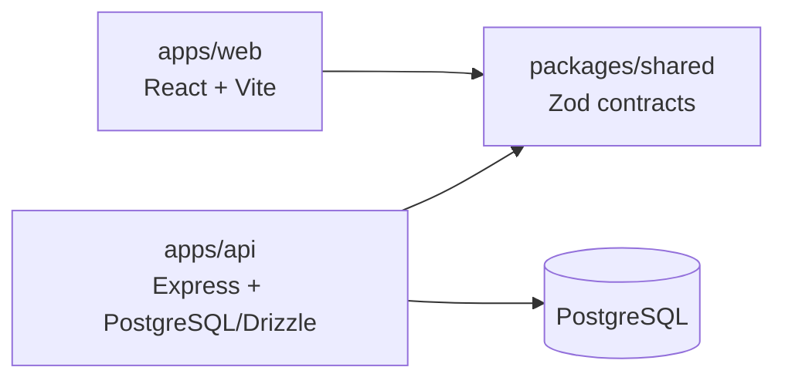

# Phase 1 architecture

This document describes the foundation that is implemented now. Sections labeled **Future boundary** are constraints for later work, not claims that the feature exists.

## Ownership and dependency direction

- Root files own npm workspace orchestration, common TypeScript/ESLint policy, the lockfile, and local Compose configuration.
- `apps/web` owns browser bootstrap, routes, layouts, reusable UI, localization, public configuration, and HTTP consumption.
- `apps/api` owns Express composition, routes/middleware, process lifecycle, server configuration, PostgreSQL, Drizzle schema, and migrations.
- `packages/shared` owns framework-neutral runtime schemas and inferred types. Its current public contract is the health response.
- `apps/web` and `apps/api` consume `@elevator/shared` through its public package entry. Shared never imports an application, and applications never import each other's source.

## Browser request flow

1. `apps/web/src/main.tsx` reads `import.meta.env` once.
2. Zod validates and normalizes `VITE_API_BASE_URL`; browser code receives a typed `WebConfig` rather than reading environment globals throughout the application.
3. The generic API client requests `GET /api/health` through TanStack Query.
4. Express applies narrow CORS for the exact configured `WEB_ORIGIN`, parses requests, and dispatches through the health router.
5. The API constructs and validates the response with `healthResponseSchema` from `@elevator/shared`.
6. The browser validates the response with the same public schema and maps loading, valid success, and every safe failure to localized UI states.

The health route is unauthenticated process liveness. It deliberately does not query PostgreSQL or expose configuration, readiness, versions, credentials, or infrastructure details. CORS controls browser transport only; it is not authentication or authorization.

## Server configuration and lifecycle

The development process loads the ignored root `.env`; production must inject environment values externally. `apps/api/src/server.ts` is the only API runtime module that reads `process.env`. Its Zod parser validates mode, port, exact web origin, and PostgreSQL URL, then passes typed values into composed modules.

`createApp` configures Express without opening a listener, allowing Supertest to exercise the complete HTTP pipeline in process. `server.ts` separately owns listening, signals, and resource shutdown. `SIGINT` and `SIGTERM` stop new HTTP work, close the HTTP server, then await the database pool close inside a bounded shutdown path. Startup and shutdown errors use sanitized messages.

Central middleware returns structured JSON for unknown routes, malformed JSON, and unexpected errors without stack traces or raw details.

For Vercel, `apps/api/index.ts` is a separate serverless entry point. It validates the same environment contract and default-exports the composed Express application without binding a port, installing signal handlers, or creating an unused database pool. The local `src/server.ts` remains the sole owner of the long-running listener and graceful-shutdown lifecycle.

The web and API deploy as two Vercel projects rooted at `apps/web` and `apps/api`. Each tracked Vercel build compiles the shared workspace first. The web deployment emits static Vite assets and applies an SPA fallback; the API deployment runs Express as a Node.js 24 Function. This is deployment scaffolding, not evidence that the repository has been deployed or is production-ready.

## PostgreSQL and Drizzle

Docker Compose runs pinned PostgreSQL 17 on loopback only. The example maps configurable host port `55432` to container port `5432`, uses a named volume, and declares a `pg_isready` health check.

The API creates one bounded `pg.Pool` and wraps it with Drizzle. Construction is lazy: it does not open a connection or run a query simply because the API starts. The owned resource provides an idempotent close operation. `npm run db:check` is the explicit readiness probe and always attempts to close its pool.

Drizzle schema and generated migration artifacts belong to `apps/api`. The Phase 1 schema intentionally contains no domain tables. Generation and application are explicit developer/deployment actions; API startup never generates or applies migrations.

## Localization and direction

Arabic (`ar`) is the default locale and uses RTL; English (`en`) uses LTR. The typed English message keys define the resource shape, and Arabic must satisfy that same shape at compile time.

At startup, the i18n factory accepts only a validated `ar` or `en` value from non-sensitive browser storage key `elevator.locale.v1`. Invalid or unavailable storage falls back to Arabic. The global provider keeps messages, preference, and the root `lang`/`dir` attributes synchronized from one locale state. Layout uses logical/direction-aware spacing, and both directions share the same routes and components.

## Frontend product preview boundary

The web application includes two frontend-only evaluation surfaces: the operations prototype under `/demo` and the company website concept at `/website-preview`. Demo pages are code-split behind the existing router and share the global locale and theme providers. The operations shell provides responsive navigation, localized dates, search and filters, read-only details, and a calendar interaction.

All sample organizations, elevators, requests, technicians, and visits are deterministic imports from `apps/web/src/demo/data.ts`. They are never fetched from or written to PostgreSQL, and the API still exposes only `GET /api/health`. Controls that would create, assign, archive, export, or submit data are visibly disabled as preview-only actions. The preview is not authentication, authorization, a customer portal, or an implementation of any business domain.

The selected theme is validated and persisted in non-sensitive browser storage key `elevator.theme.v1`; it has no server-side meaning. Route modules are loaded lazily so the public concept and individual operational screens remain separate frontend bundles.

## Future authentication and authorization boundary

**Future boundary — not implemented in Phase 1.** Authentication and deny-by-default authorization belong at the Express/API boundary. Every protected operation must verify identity, role/capability, tenant/customer scope, and object-level permission on the server. Client route guards and hidden controls may improve user experience but can never grant or enforce access.

Non-negotiable invariants:

- Customers may access only their own customer/tenant data.
- Technicians may access only explicitly authorized assignments.
- Technicians must never delete or archive customer maintenance requests.

## Future audit boundary

**Future boundary — not implemented in Phase 1.** Important mutations must produce append-oriented audit information containing actor, action, target, timestamp, and minimized relevant context or before/after data. Authorization decisions and audit production should share the authenticated server context. Secrets and unnecessary personal data must never be copied into audit records.

## Future Socket.IO boundary

**Future boundary — not implemented in Phase 1.** Socket.IO should attach to the composed HTTP server rather than create a parallel application lifecycle. The handshake must use the same server-side identity and policy layer as HTTP. Every subscription and room join requires server-side authorization, including tenant and assignment scope, and emitted events must be sanitized after authorization. No real-time transport, rooms, presence, or notification behavior exists yet.

## Phase 1 threat notes

- Browser bundles are public. Only validated `VITE_API_BASE_URL` is exposed; database and server settings remain outside web source and output.
- CORS restricts allowed browser origins but does not stop direct clients or replace authorization.
- Configuration and operational errors are redacted to reduce secret, path, and infrastructure leakage.
- Shared response validation prevents malformed health payloads from being treated as success.
- Explicit migrations and API-owned schema reduce accidental schema drift; operational review is still required before production migration.
- Package boundaries prevent browser/server coupling and keep reusable contracts portable.
- Locale validation prevents stale storage from creating unsupported language/direction state.
- No authentication, authorization, rate limiting, CSRF strategy, audit store, backups, production monitoring, or deployment controls exist yet; these are production blockers, not implicit capabilities.

## Historical plan deviation

Early approved plans proposed `GET /api/v1/health` and API port `3000`. Story 02 implementation and subsequent acceptance established `GET /api/health`; Story 04/05 aligned local development to API port `3100`. The implemented route and environment examples are authoritative. Historical plan text remains under `.squad` for traceability, with the overview recording this deviation.
